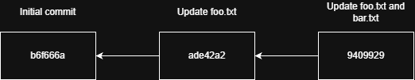
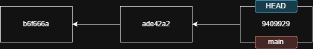
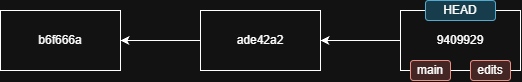
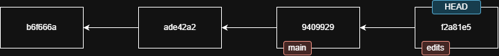
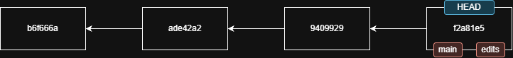
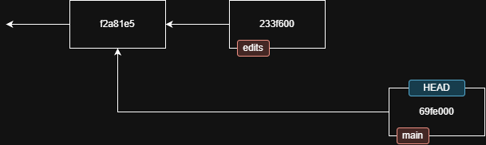
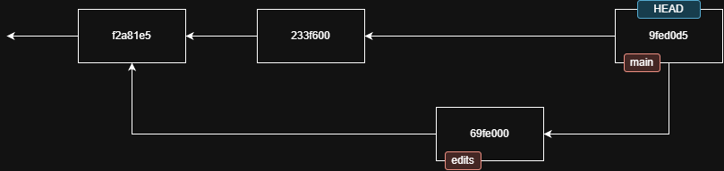
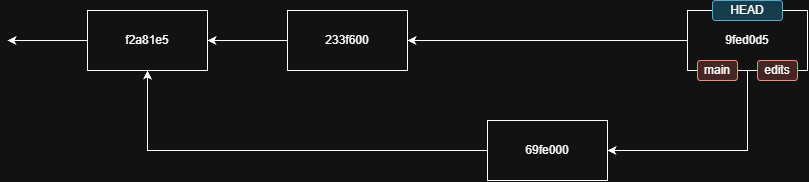
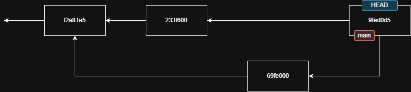

# Branching out
Writing software in a team setting is messy. Each developer has their own priorities and tasks, and inevitably, we need
to modify the same resources at the same time. Git was baptized with fire in its early days by acting as the system of
choice for Linux kernel development. The primary tool in its arsenal for dealing with this problem is the branch.

Even at its inception, branching was not a new concept. In fact, the earliest system to introduce branching was SCCS, 
one of the earliest of all version control systems! Git revolutionized branching by making it more accessible. Git
branches are:
* **Extremely lightweight** - Where other systems implement branches as copies, a branch in Git is just a moving 
  pointer to a specific commit.
* **Local-first** - Creating and working with branches does not require connecting to a centralized server.
* **Easy to use** - Creating, switching, merging, and deleting branches are all lightweight processes that can be done
  locally. Instead of branch creation and management requiring administrative work, Git encourages users to create them
  routinely and without coordination to experiment or implement changes.
* **Isolated** - While this concept is not unique to Git, it is nonetheless key. A branch creates a development line 
  that is isolated from other development (at least until it needs to be merged). That allows the developer to focus on
  the changes being made, rather than continuously integrating with the work of others.

## What actually _is_ a branch?
If you have experience with other version control systems, try to forget how they implement branches. In Git, a branch
is simply a named commit from which new changes are made. _All_ changes in Git are on a branch, starting with the
"default" branch (typically named `main` or `master`). Let's look at this with our test repository.

> [!NOTE]
> This section assumes your default branch is `main`. This is the "newer" default branch name, with the "older" standard
> being `master`. Functionally, there is no difference. In fact, your default branch can be named anything you choose
> and there's nothing magical about it _being_ the default branch other than it is the first branch created in your
> repository.

Let's assume after testing, your repository currently has the following commits (remember, a commit points to its 
parent, which is why the arrows point "backwards"):



Before we discuss the branch we're on, let's introduce one additional concept: `HEAD`. `HEAD` is a pointer that 
represents your current working environment. Commands like `git commit`, `git checkout`, and `git switch` all 
automatically move the pointer. So far, we've used `git commit`, which creates a new commit object from the contents of
the staging area and then changes `HEAD` to point to the new commit. So for our repository, `HEAD` points to commit 
`9409929`.

When we created our repository (using `git init`), Git automatically created our first branch[^1], called `main`. This
is just another pointer, and is also automatically moved with each commit (to the branch) as well. So here is our graph 
with `HEAD` and `main` annotated:



## Creating and switching branches
The primary tool for working with branches are the `git branch` and `git switch` commands:
* `git branch` is a branch management tool used to create, list, rename, and delete branches
* `git switch` is a branch navigation tool that moves your working environment (`HEAD`) to a different branch. It 
  includes convenience options that do the work of certain `git branch` operations.
Rather than detail these commands here, we're just going to get to using them right away by creating a new branch!

> [!NOTE]
> `git switch` is a newer command (introduced in 2019) as a way to clean up the use of `git checkout`. We won't go into
> the details of this change here, but you will very likely come across commands like `git checkout -b branchname`, 
> which is equivalent to `git switch -c branchname`. This guide will use the newer syntax, but the older syntax is (and
> likely will always be) also valid.

Create and switch to a branch named `edits`:
```bash
$ git switch -c edits
$ git status
On branch edits
nothing to commit, working tree clean
```
Now we have a new branch pointer on our graph. Note that the `HEAD` pointer still points to the same commit. However, 
Git has updated the pointer to follow `edits` instead of `main`:



## Making changes on a branch
Let's create a new commit. Edit `foo.txt` and add a line at the top of the file. Add it to your staging area and commit
the change. The graph now looks like this:



Note that we aren't drawing this "to the side" of the `main` branch. In line with the mentality that a branch is simply
a pointer, Git graphs are usually drawn according to the relationships between commits, rather than the relationships 
between branches. At the moment, there is actually no divergence between `main` and `edits` other than what commit the
branches point to. 

## Merging trivial histories
Let's get those changes into `main`.

There are actually _many_ ways to merge changes in git, but the primary techniques are:
* **Three-way merge** - Creates a merge that ties two parent commits together. A new commit is created applying the 
  changes from the merged branch. 
* **Fast-forward merge** - When the target branch hasn't diverged, we can just move the branch pointer forward. 

> [!NOTE]
> Three way merges are required when merging divergent histories and optional any time a fast-forward merge is possible
> (by supplying the `--no-ff` flag).

In most cases, Git will choose between these options for us when we use the `git merge` command.

To merge our changes, we first switch back to `main`, then issue a `git merge` command against the `edits` branch:
```bash
$ git switch main
Switched to branch 'main'
$ git merge edits
Updating 9409929..f2a81e5
Fast-forward
 foo.txt | 1 +
 1 file changed, 1 insertion(+)
```
Git simply moves the `main` pointer forward to the same commit as `edits`:



## Messier changes
Let's do something a little more complex. 
* Start by switching back to `edits` (`git switch edits`).
* Then modify `bar.txt` to change the first line. Save, stage, and commit.
* Switch back to `main`, modify the same line (but with different text) in `bar.txt`. Save, stage, and commit.

We now have two divergent changes which will conflict with one another. Our graph looks like this (we've removed some 
older nodes to keep the graph from outgrowing your screen):



If we didn't have conflicts, issuing `git merge edits` from `main` would result in Git pulling both changes into a new
commit called a "merge commit". But we have conflicts... so what happens now? Let's find out! We're already on `main`, 
so:
```bash
$ git merge edits
Auto-merging bar.txt
CONFLICT (content): Merge conflict in bar.txt
Automatic merge failed; fix conflicts and then commit the result.
```
Git recognized it cannot automatically combine our changes, so instead it pauses the merge process and marks a conflict.
This is done with special text markers inside the conflicting file:
```diff
<<<<<<< HEAD
test modification on main
=======
test edit on `edits` branch.
>>>>>>> edits
modification 2
```
To clear the conflict, you can manually edit the file to resolve the conflict (and delete the surrounding markers), 
then stage and commit it. This will also complete the merge, making our commit graph look like this:



There are a few key things to note:
* Commit `9fed0d5` has two parents, which tells us this is a merge commit. There are even ways to do merges with more 
  than two parents (called "octopus merges"), though these are rare.
* We merged `edits` to `main`. However `edits` itself has not changed. If we wish to continue working in `edits` and
  incorporate the results of the merge, we must go to the `edits` branch and merge `main` into it. Because of the merge
  commit, this will be a fast-forward merge. Do this now:
  ```bash
  $ git switch edits
  Switched to branch 'edits'
  $ git merge main
  Updating 233f600..9fed0d5
  Fast-forward
   bar.txt | 2 +-
   1 file changed, 1 insertion(+), 1 deletion(-)
  ```



## Deleting branches
Since branches are just pointers, it's often convenient to get rid of them. Don't worry... no history is lost! We just
don't always need to carry around the branch name (especially for local branches). To delete a branch, first switch to
another branch (you can't delete the branch you're on), then use `git branch -d <branchname>` to remove it.
```bash
$ git switch main
Switched to branch 'main'
$ git branch -d edits
Deleted branch edits (was 9fed0d5).
```

This leaves the graph intact, and simply removes the branch pointer:



> [!NOTE]
> Need it back? No problem! You'll need the hash the branch was pointing to. In our case, that was just the merge commit
> (`9fed0d5`), but you can also use `git reflog` to locate a recently removed branch hash (useful if an unmerged branch
> was deleted, since the tip of the branch won't be easily found with `git log`). Now use 
> `git switch -c <branchname> <hash>` to recreate the branch pointer:
> ```bash
> $ git switch -c edits 9fed0d5
> Switched to a new branch 'edits'
> ```

[^1]: Technically, it sets up an "unborn" initial branch that will be created on the first commit.
---
[Home](./README.md) | [Previous: Day-to-day Git](./day-to-day-git.md) | [Next: Collaborating](./collaborating.md)
