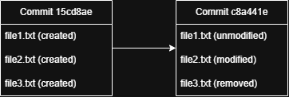
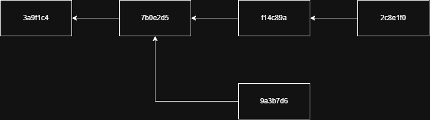

# The Git mindset
> [!NOTE]
> If you're coming from an older version control system like SVN or CVS and you're having trouble making the leap
> to Git, try putting the concepts from the old system out of your mind entirely. Git conceptually works quite 
> differently in many fundamental ways and sometimes it's difficult to map ideas from one system to another.

## Snapshots, not deltas
Most older version control systems fundamentally worked by starting with a "base" version of the file (either the first
revision or the most current) and storing "deltas" for each version. You can think of a delta as a set of instructions
on how to change one file to look like another. (You can generate just this sort of information with the Linux `diff`
command (`diff -u test1.txt test2.txt`)).

As systems grew more complex, solutions had to be found to track not only the contents of files, but also the file 
systems they were contained in (new files, deleted files, renamed files, and directories). These problems were solved, 
but ultimately these systems still fundamentally tracked changes to individual elements within the repository.

Git turns this problem inside-out and tracks each change (commit, in Git parlance) as a new "snapshot" of the _entire_
repository filesystem. Committing a change doesn't create a new version for each changed file, it creates a new version
of the whole repository! (Of course, unmodified files aren't actually duplicated for each version. Instead Git creates a
lightweight link to the intended state of the file for that commit.)

For example:

* Commit `15cd8ae` creates three files (`file1.txt`, `file2.txt`, and `file3.txt`)
* Commit `c8a441e` updates `file2.txt` and deletes `file3.txt`

## Content-addressable storage
Instead of storing files directly, Git stores immutable "objects" keyed by the SHA-1 hash of its contents. These objects
can be one of four core object types:
* blob - File Content
* tree - Directory
* commit - A "snapshot" (technically a reference to the root tree object of the repository) combined with various
  metadata
* annotated tag - A reference to another object (usually a commit) along with additional metadata

If this feels a bit deep in the weeds, it's because it is! The key takeaway is that a Git repository is essentially a
local database with "records" keyed by the SHA-1 hash of their contents (and other metadata). When we talk about 
commits, we're really just talking about an object that represents a particular snapshot of the repository's contents. 

> [!NOTE]
> In most examples in this text, you'll see a commit hash shown as an abbreviated "prefix", which is common  practice 
> when using Git. All Git commands will accept a hash prefix as short as 7 characters so long as it unambiguously 
> references a single commit.

## The DAG (commit graph)
DAG stands for Directed Acyclic Graph, which is a fancy name for a relatively straightforward concept. Let's break it
down into its components:
* Graph - a collection of connected nodes (commits)
* Directed - connections go in one direction; specifically, **a commit always points _backward_ to its parent 
  commit(s)**
* Acyclic - there are no loops; you cannot follow connections back through history and arrive at a commit you've
  already visited

For example, a DAG might look something like this:

> [!NOTE]
> Most users never use the term "DAG". This concept is often just called a commit graph, or even just "history".

## Local-first
A key concept in Git is that it is decentralized. In fact, when you clone a repository, you get a copy of every
revision, branch, merge, and tag in the repository you cloned. In theory, this would allow _any_ repository clone to 
become the source of truth for any other clone. In practice, most teams designate a server-located copy (the "remote") 
to be the "source of truth" for the repository. 

Nearly all git commands are written with this local-first mentality. They operate directly on the local copy without
consulting the remote. When appropriate for the user's workflow, special commands are used to synchronize local state 
with the remote, pulling down new changes and/or pushing up changes made locally.

---
[Home](./README.md) | [Previous: Versioning through the ages](./history.md) | [Next: Getting Started](./getting-started.md)
