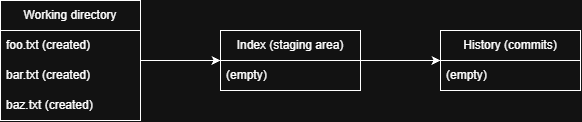
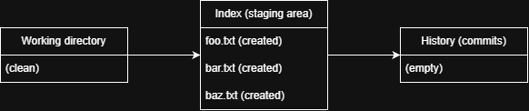
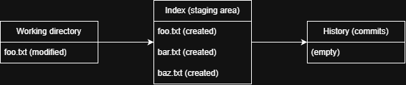

# Making changes
Let's dig into day-to-day interaction with git. For now, we'll ignore branching and remotes and concentrate just on 
making changes.

> [!IMPORTANT]
> If you haven't already, create a local repository (`~/repos/my-repo` below) using `git init` as discussed in the 
> [Getting started](./getting-started.md) section.

## Understanding file states
Git defines three primary states/areas for file changes to reside in:
* **Working directory** - These are the files you directly interact with. After checking out (or creating) a repository,
  these files will be located in the repository folder (all other states are stored inside the hidden `.git/` folder).
  You work with these files in the normal manner (text editor, IDE, etc.): creating, modifying, renaming, and deleting
  as necessary. If you change a file or directory here, Git will recognize that it has been modified.
* **The index (staging area)** - Provides a "staging area" called the "index" for assembling a desired change to history
  (called a commit). Though technically the term "index" is more correct, most users call this the "staging area" or 
  just "staging". The staging area is a _tool_ for planning commits. As you modify files for a given commit, you can 
  add/remove those modifications to/from the index (referred to as "staging" the changes). Or if you are working on
  multiple (non-overlapping) modifications, you can stage all the files for one modification and commit that fileset
  only.
* **History** - Official record of commits to the repository. Commits are _always_ created from the staging area, which
  acts as a representation the intended change. Once created, a commit cannot be modified[^1]. 

> [!NOTE]
> It's useful to be aware of the difference between "tracked" and "untracked" files. A "tracked" file is one that has
> been at least staged (though it will become "untracked" again if the file is unstaged without being committed). All 
> other files are "untracked" in that the git repository is "unaware" of their presence (though git itself may reference
> them in commands like `git status`).

> [!IMPORTANT]
> Let's prepare an initial state for our test repository. In the root of the repository directory, create three files 
> (`foo.txt`, `bar.txt`, and `baz.txt`). 

Our three areas now look like this:



## Checking repository status
If there's any Git command you'll learn with raw muscle memory, it's `git status`. This command provides information on
the state of your local repository and synchronization with its remote (if it has one). Let's run it on our test 
repository:
```bash
$ git status
On branch main

No commits yet

Untracked files:
  (use "git add <file>..." to include in what will be committed)
        bar.txt
        baz.txt
        foo.txt

nothing added to commit but untracked files present (use "git add" to track)
```
`git status` tells us the following:
* **Branch information** - What branch we're on and whether we're up-to-date with the information we have for the 
  remote[^2]. We are on branch `main` (or `master`, depending on your settings) and we do not have a remote, so remote 
  information is not present.
* **Changes to be committed (staging area)** - Files that have been staged and are ready to be included in the next 
  commit. We haven't staged anything yet, so this section is absent.
* **Untracked files** - File changes in the working area that are not staged. Here we see all three of our new files.
  Git provides helpful tips on how to get the changes to the next state (staged).

## Staging changes
Let's get our files into the history. We start _planning_ our commit by adding our files to the staging area. There are
many different ways we can do that, all using the command `git add`. 

> [!IMPORTANT]
> Pick a command and get the new files staged into `my-repo`
> ```bash
> # stage individual files one at a time
> $ git add foo.txt
> $ git add bar.txt
> $ git add baz.txt
> # or
> $ git add foo.txt bar.txt baz.txt
> 
> # stage all changes in a specific directory (and subdirectories) (in this case, all files in the current directory)
> $ git add .
> 
> # stage multiple files using normal wildcard/glob patterns
> $ git add *.txt
> 
> # stage all changes across the entire repository (use with care)
> $ git add -A
> # or 
> $ git add --all
> ```
> Run `git status` again and let's see what we have:
> ```bash
> On branch main
> 
> No commits yet
> 
> Changes to be committed:
>   (use "git rm --cached <file>..." to unstage)
>         new file:   bar.txt
>         new file:   baz.txt
>         new file:   foo.txt
> ```
Our repository now looks like this:



## Curveball
Before we go any further, let's change things up a little. 

> [!IMPORTANT]
> Open `foo.txt`, make a small change and save it. Then run `git status`.
> ```bash
> $ git status
> On branch main
> 
> No commits yet
> 
> Changes to be committed:
>   (use "git rm --cached <file>..." to unstage)
>         new file:   bar.txt
>         new file:   baz.txt
>         new file:   foo.txt
> 
> Changes not staged for commit:
>   (use "git add <file>..." to update what will be committed)
>   (use "git restore <file>..." to discard changes in working directory)
>         modified:   foo.txt
> ```
Git has our original file contents staged, and is noting there is an unstaged change to `foo.txt`. Typically this would
be a last-minute adjustment and we'd simply do an additional `git add` on the file. But in this case, we'll think of
this modification as a new, unrelated change and leave it as-is.

Now our repository looks like this:



## What changed?
Before we commit our change, what if we want to see more information than just list of the files we're about to make 
changes to? For this (and a lot of other scenarios), Git provides the `git diff` command. There are a lot of ways to 
use this command, but these are some typical scenarios:
* `git diff` (no arguments) - changes in the working directory that haven't been staged
* `git diff --staged` - changes that are staged, but not yet committed
* `git diff HEAD` - all changes (staged and unstaged) as compared to the last commit (since we've not yet made a commit,
  this command will result in an error).

Try `git diff --staged` on your test repository:
```bash
$ git diff --staged
diff --git a/bar.txt b/bar.txt
new file mode 100644
index 0000000..9daeafb
--- /dev/null
+++ b/bar.txt
@@ -0,0 +1 @@
+test
diff --git a/baz.txt b/baz.txt
new file mode 100644
index 0000000..9daeafb
--- /dev/null
+++ b/baz.txt
@@ -0,0 +1 @@
+test
diff --git a/foo.txt b/foo.txt
new file mode 100644
index 0000000..9daeafb
--- /dev/null
+++ b/foo.txt
@@ -0,0 +1 @@
+test
```
You can also specify the file path you want to diff if you only care about specific files or directories:
```bash
$ git diff --staged -- foo.txt
diff --git a/foo.txt b/foo.txt
new file mode 100644
index 0000000..9daeafb
--- /dev/null
+++ b/foo.txt
@@ -0,0 +1 @@
+test
```
(Note the `--` separator. This tells git diff that everything after this separator is a path, not a flag).

## Committing changes
> [!IMPORTANT]
> We've carefully planned our change, now let's make it official and commit it!
> ```bash
> $ git commit -m "Initial commit"
> ```
Note we've used the `-m` flag to specify our "commit message". If we don't do this, Git will automatically open a
text editor to compose a commit message. Either option is fine, but please take time to compose a good commit message.

> [!NOTE]
> What's a "good" commit message? Well, there's no "good" answer to that question. This author will make the 
> following suggestions. The _real_ answer lies with your organization and fellow developers:
> * If using an issue tracking system, start with the issue number. Try to keep the format consistent.
> * Follow (on the same line) with a short, high-level, human-language description of what was changed. 
> * If more detail is desired, separate with an empty line and then provide a more detailed description of the change.
> 
> Git tooling (e.g. GitHub) is often optimized for a 50/72 structure: 
> ```
> Capitalized, imperative summary line (50 chars or less)
> 
> More detailed explanatory text, if necessary. Wrap to about 72
> characters per line. Explain the PROBLEM this commit is solving
> and WHY you chose this solution.
> ```

Now let's run `git status` and see where we are.
```bash 
$ git status
On branch main
Changes not staged for commit:
  (use "git add <file>..." to update what will be committed)
  (use "git restore <file>..." to discard changes in working directory)
        modified:   foo.txt

no changes added to commit (use "git add" and/or "git commit -a")
```
Our staged changes are committed, leaving only the unstaged change in our working directory. Our repository now looks 
like this:


The value in the History column is a hash prefix for our new commit (your value will be different).

---
[Home](./README.md) | [Previous: Getting started](./getting-started.md) | [Next: Review & undo](review-and-undo.md)

Copyright © 2026 Aaron Craven.

[^1]: While this is technically true, there are ways to "rewrite history". These techniques do not modify existing 
    commits, but rather remove them from the graph and re-create new (modified) commits in their place.
[^2]: `git status` does not retrieve information from the remote, but works on the currently known information. To 
    update information about the remote, we use `git fetch`, which is discussed in [Collaborating](collaborating.md).
