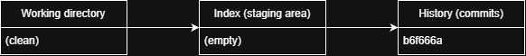

# Review & Undo
We've made changes and moved them through the three working areas. Great! But how do we see those changes and how do 
we undo mistakes?

## Viewing the commit history
To see changes in our commit history, we use `git log`. This command has an incredibly rich set of options (far too 
many to list here). 

The basic command (`git log` with no arguments) lists the entire commit history of the current branch, starting with 
the most recent commit and going all the way back to the initial commit.

Other options include:
| Option                       | Description                                                                        |
| ---------------------------- | ---------------------------------------------------------------------------------- |
| `--oneline`                  | Display each commit in a compact, one-line format                                  |
| `--graph`                    | Display a text-based graph of commits (useful when examining branches)             |
| `--all`                      | View changes across the repository, not just the current branch                    |
| `-n <number>` or `-<number>` | View only the last `<number>` commits                                              |
| `--stat`                     | Include high-level file insertion/deletion statistics for each commit              |
| `--author="<author>"`        | Filter commits to those written by a specific author                               |
| `--grep="<searchtext>"`      | Filter commits to those containing specific search text in the commit message      |
| `-S "<searchtext>"`          | Filter commits to those that added or removed the exact search text within content |
| `-- <path>`                  | Filter commits to those containing a single file path                              |

Some common combinations:
* `git log --oneline -n 20` - Quick history of recent commits (specifically, the last 20)
* `git log --graph --oneline --all` - A text-based graphical view of the commit tree for the repository. Many 
  developers create an alias for this command as `git tree`
* `git log --oneline -- foo.txt` - The commit history of `foo.txt` starting in the current branch (add `--all` to see 
  it across the whole repository)

Give these a try in our repository. The results won't be particularly interesting until we've made more changes, but
you can come back to this list as we make more and more changes.

## Undoing local mistakes
As developers, we're pretty good at getting everything right the first time. But on _very rare occasions_, we do make
mistakes. So how do we deal with these? Well, that depends on where our changes are in the process. Here are a few
common scenarios:

### Changes in the working directory we want to discard
Use `git restore <file>` to return `<file>` to the version in the staging area (if present) or the version in the last 
commit (if not). This overwrites your local file edits permanently. It will not modify untracked files.

## Changes in the staging area that we want to unstage
Use `git restore --staged <file>` to remove `<file>` from the staging area, but retain the change in the working 
directory. (Note: if `<file>` is both in the staging area _and_ has working directory changes, this command will remove
it from the staging area, but will not modify the working directory copy.)

## Return the contents of a file to the state at a specific commit
Use `git restore --source=<commit> <file>`, where `<commit>` is any reference to any other commit. This can be specified
in multiple ways:
* `git restore --source=abcd123 foo.txt` - specified by commit hash
* `git restore --source=HEAD~3 foo.txt` - specified by history on the current branch (this is three commits ago on the
  current branch)
* `git restore --source=branch-or-tag-name foo.txt` - specified as a tag name or the tip of any branch

Let's try this out. We currently have a file in the working area that we modified. Let's discard those changes:
```bash
$ git restore foo.txt
$ git status
On branch main
nothing to commit, working tree clean
```

Our repository looks like this now:



## Take time to play!
Before moving on, take some time to play with your test repository. Add changes, files, directories, and anything else 
you might want to experiment with. Just don't remove any of the three test files, as they will be referenced in later
sections.

---
[Home](./README.md) | [Previous: Making changes](./making-changes.md) | [Next: Branching out](./branching.md)

Copyright © 2026 Aaron Craven.

